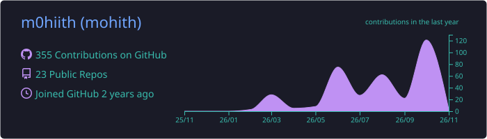
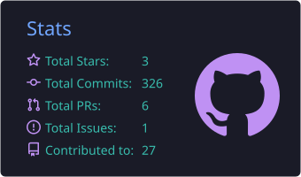
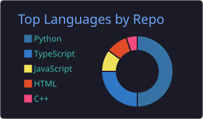
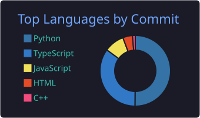
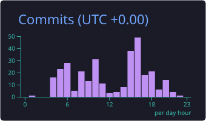

<!-- ═══════════════════════  HEADER  ═══════════════════════ -->
<p align="center">
  
</p>

<p align="center">
  <a href="https://mohith.site">
    
  </a>
</p>

<p align="center">
  <a href="https://mohith.site"></a>
  <a href="mailto:info@tptmediahouse.com"></a>
  <a href="https://huggingface.co/m0hiith"></a>
  
</p>

<p align="center">
  <a href="https://github.com/m0hiith?tab=followers"></a>
  <a href="https://github.com/m0hiith?tab=repositories"></a>
</p>

<!-- ═══════════════════════  ABOUT  ═══════════════════════ -->


## 🧑‍💻 About Me

```ts
const mohith = {
  role:        "Full-Stack + AI Engineer · Embedded IoT Builder",
  base:        "India 🇮🇳",
  building:    ["TalentSia — AI career platform", "BLOOM — AI trading terminal", "TwinDock — warehouse digital twin"],
  stack:       ["TypeScript", "Python", "Next.js", "Supabase", "FastAPI", "PyTorch", "ESP32 / SiWx917"],
  aiTools:     ["Claude", "Gemini", "Hugging Face", "Agents & MCP"],
  shipsTo:     ["Vercel", "Render", "Hugging Face Spaces"],
  funFact:     "If it can be automated, I've probably already written the bot 🤖",
};
```

- 🔭 Building **[TalentSia](https://app.talentsia.in/)** — an AI-powered career platform
- 🔌 Hacking on **Silicon Labs SiWx917** & **ESP32** — digital twins, robotic fish, CI for firmware
- 📈 Making **AI trading terminals** for NSE/BSE & crypto
- 🎨 Designing landing pages & sites for brands via **TPT Media House**
- ⚡ Fun fact: 30+ repos, 20+ live deployments and counting

<!-- ═══════════════════════  TECH STACK  ═══════════════════════ -->


## 🛠️ Tech Arsenal

<h3 align="center">💻 Languages</h3>
<p align="center">
  
</p>

<h3 align="center">⚛️ Frontend</h3>
<p align="center">
  
</p>

<h3 align="center">🧠 Backend · Data · AI/ML</h3>
<p align="center">
  
</p>

<h3 align="center">🔌 Embedded · IoT</h3>
<p align="center">
  
</p>

<h3 align="center">☁️ DevOps · Cloud · Tools</h3>
<p align="center">
  
</p>

<p align="center">
  
  
  
  
  
  
  
  
  
  
  
  
  
  
  
  
</p>

<!-- ═══════════════════════  PROJECTS  ═══════════════════════ -->


## 🚀 Featured Projects

<table>
<tr>
<td width="50%" valign="top">

### 🎯 [TalentSia](https://github.com/m0hiith/TalentSia)
AI-based career platform — matching, job-news pipeline & landing.
<br/>


<br/>🔗 <a href="https://app.talentsia.in/">app.talentsia.in</a>

</td>
<td width="50%" valign="top">

### 📈 [BLOOM Workstation](https://github.com/m0hiith/groww-trading-setup)
Bloomberg-style AI trading terminal (Textual TUI) for NSE/BSE via Groww.
<br/>


</td>
</tr>
<tr>
<td width="50%" valign="top">

### 🏭 [TwinDock](https://github.com/m0hiith/twindock)
Browser-based warehouse digital twin driven by a SiWx917 board over Wi-Fi/MQTT.
<br/>


<br/>🔗 <a href="https://twindock.onrender.com/twin">Live demo</a>

</td>
<td width="50%" valign="top">

### ✅ [SiliconFlow CI](https://github.com/m0hiith/siliconflow-ci)
Build, test & release gating for embedded firmware — Actions executes, SiliconFlow decides what ships.
<br/>


</td>
</tr>
<tr>
<td width="50%" valign="top">

### 🐟 [AquaFish](https://github.com/m0hiith/aquafish-esp32-robotic-fish)
Single-file web simulator & design explainer for an ESP32 robotic fish.
<br/>


</td>
<td width="50%" valign="top">

### 📊 [SiWx917 DV Harness](https://github.com/m0hiith/siwx917-dv-harness)
Unattended power/link validation on SiWx917 kits — mean, std & SEM vs the AEM's real resolution.
<br/>


<br/>🔗 <a href="https://siwx917-dv-harness-viz.vercel.app">Live viz</a>

</td>
</tr>
<tr>
<td width="50%" valign="top">

### 🧾 [TaxMitra (AI-Taxer)](https://github.com/m0hiith/AI-taxer)
AI tax assistant for Indian taxpayers.
<br/>


<br/>🔗 <a href="https://taxmitra-six.vercel.app">Live</a>

</td>
<td width="50%" valign="top">

### 👁️ [EdgeHive Object Detection](https://github.com/m0hiith/basic-object-detection)
Real-time webcam object detection with Ultralytics YOLO.
<br/>


</td>
</tr>
</table>

<details>
<summary><b>🌐 More live deployments — click to expand</b></summary>
<br/>

| Project | Live |
|---|---|
| 🧑‍💼 BharatWork | [bharatwork.vercel.app](https://bharatwork.vercel.app) |
| 🧭 Nexus Web | [nexus-web-beta-seven.vercel.app](https://nexus-web-beta-seven.vercel.app) |
| ⚔️ Solo Levelling | [solo-levelling-sigma.vercel.app](https://solo-levelling-sigma.vercel.app) |
| 🎨 Prompt Gallery | [prompt-gallery-vert.vercel.app](https://prompt-gallery-vert.vercel.app/) |
| 🪙 Binance Trading Bot | [binance-trading-bot-sepia.vercel.app](https://binance-trading-bot-sepia.vercel.app/) |
| 🔍 Redrob Ranker | [HF Space](https://huggingface.co/spaces/m0hiith/redrob-ranker-sandbox) |
| 📣 ScaleUp Marketing | [scaleupmarketing.in](https://www.scaleupmarketing.in/) |
| 🎬 TPT Media House | [tpt-media-website.vercel.app](https://tpt-media-website.vercel.app) |
| 🚗 Richy Travels | [car-bus-rentals.vercel.app](https://car-bus-rentals.vercel.app) |
| 🌿 Sreevedaa | [sreevedaa-landing.vercel.app](https://sreevedaa-landing.vercel.app) |
| 🏫 GTEC Redesign | [gtec-redesign.vercel.app](https://gtec-redesign.vercel.app) |
| 🏆 FEG Hackathon — Team Nova | [feg-session-engine-2.vercel.app](https://feg-session-engine-2.vercel.app/) |

</details>

<!-- ═══════════════════════  STATS  ═══════════════════════ -->


## 📊 GitHub Stats

<p align="center">
  
</p>

<p align="center">
  
  
</p>

<p align="center">
  
  
</p>

<p align="center">
  
</p>

<!-- ═══════════════════════  SNAKE  ═══════════════════════ -->
## 🐍 Watch the Snake Eat My Contributions

<p align="center">
  <picture>
    <source media="(prefers-color-scheme: dark)" srcset="https://raw.githubusercontent.com/m0hiith/m0hiith/output/github-snake-dark.svg" />
    <source media="(prefers-color-scheme: light)" srcset="https://raw.githubusercontent.com/m0hiith/m0hiith/output/github-snake.svg" />
    
  </picture>
</p>

<!-- ═══════════════════════  QUOTE + FOOTER  ═══════════════════════ -->
<p align="center">
  
</p>

<p align="center">
  
</p>

<p align="center">
  
</p>
